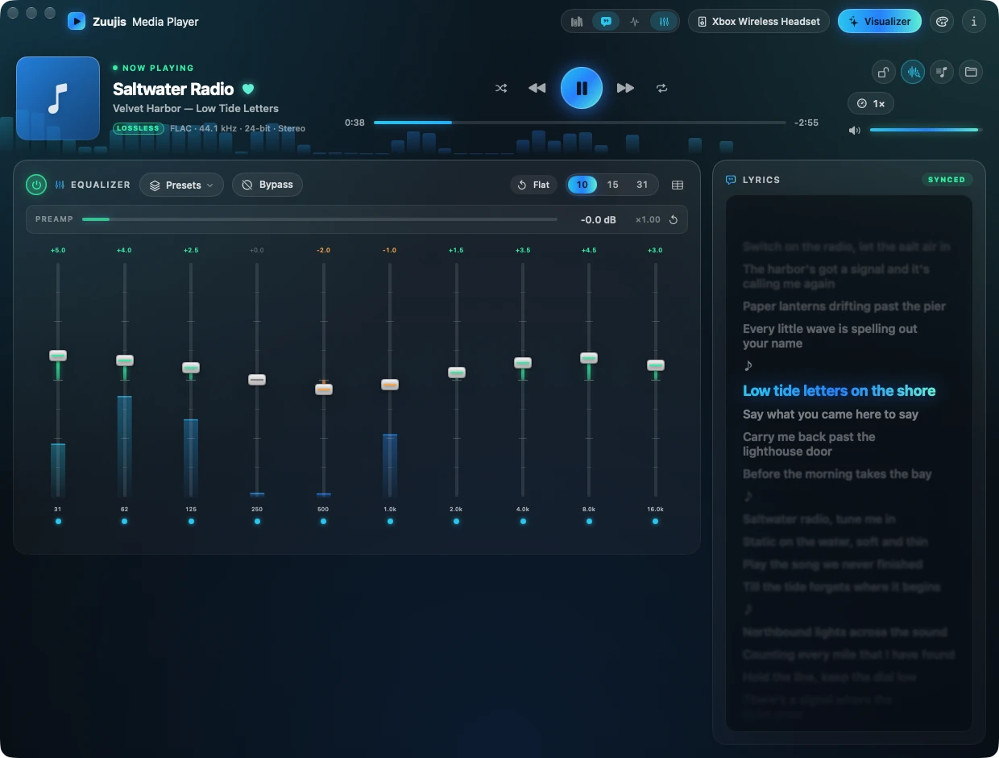
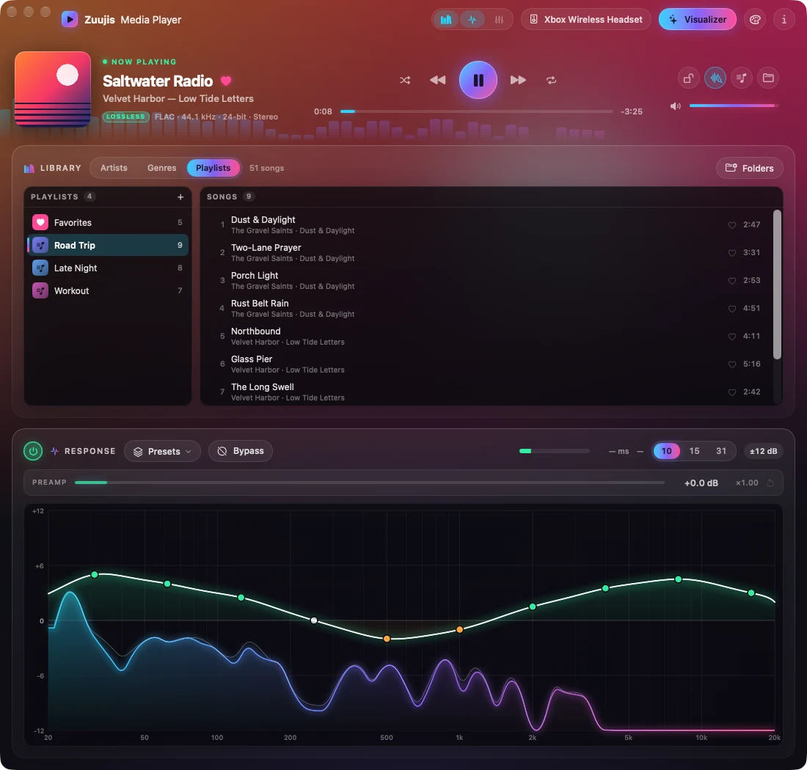
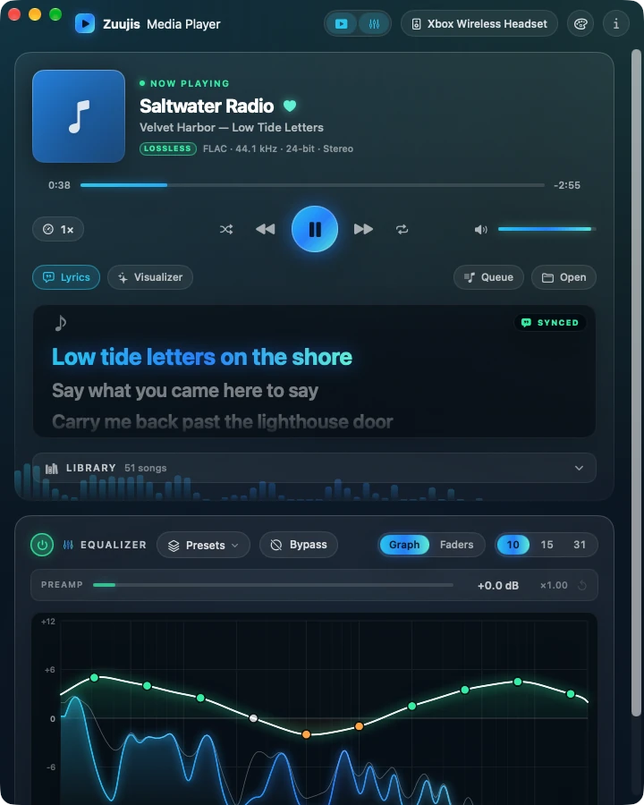
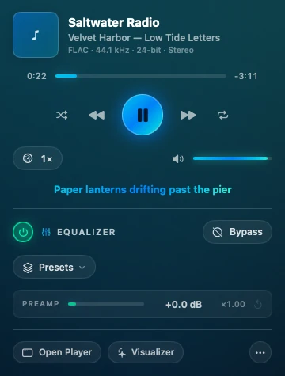
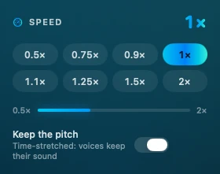
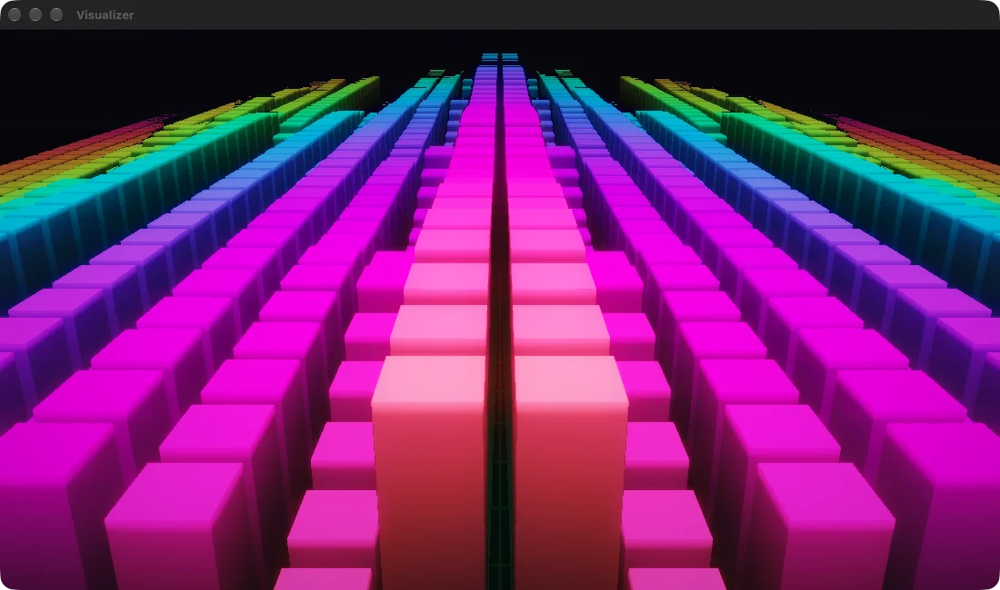

# Zuujis Media Player

A lossless music player for macOS with a system-wide equalizer and a
visualizer. The equalizer shapes and boosts whatever your Mac is playing
(music, videos, games, calls) on whichever output you are using, with no
virtual audio driver to install.


<p>


</p>

<p>



</p>



<sub>Screenshots use a made-up library; the songs and artists are not real.</sub>

- **10, 15 or 31 band graphic EQ**, from 20 Hz to 20 kHz, ±24 dB per band.
- **Master gain up to +24 dB**, for quiet laptops, speakers and headphones.
- **17 built-in presets** (Bass Boost, Vocal, Podcast/Voice, Night Mode and
  more), plus your own. Presets can be saved, imported and exported as JSON.
- **A profile for each output device.** A curve set for your headphones comes
  back automatically when you switch back to them; your TV keeps its own.
- **A response graph** that draws the EQ's curve over the live spectrum. Drag
  across it to draw the curve you want; double-click a band to reset it.
- **Bypass** (⌘B) to compare the sound with and without the EQ.
- **A responsive main window**: the Now Playing stage, the library, a lyrics
  card and the equalizer rearrange themselves to the window's width *and*
  height, from a wide window with lyrics beside the library down to a narrow
  single column.
- **Synced lyrics** that follow the song, line by line, from a `.lrc` file
  beside it or from the file's own tags. Toggle them with one click.
- **Playback speed from 0.5× to 2×**, with or without keeping the pitch.
- **Desktop widgets** (Now Playing and Equalizer, each in three sizes) with
  working play, skip, power, bypass, preset, tone and preamp buttons.
- **A menu bar item** with the player, the current lyric and the equalizer's
  controls, and **Open at Login** so it is always there.
- **A built-in file player** for lossless audio (FLAC, ALAC, WAV, AIFF) and
  MP3/AAC, with a queue, saved playlists, gapless playback and Now Playing, played through
  the same EQ.
- **A visualizer window** with 50 audio-driven modes — fractals, a raymarched
  skyline, ridgelines, a retro sunset, particle swarms and more — a shuffle
  that moves between them on the beat, and import for MilkDrop `.milk`
  presets.

## How it works

Zuujis Media Player uses the Core Audio *process tap* API added in macOS 26. When
you press Start, it:

1. Creates a **process tap** that captures everything the Mac is playing,
   except the app's own audio. While the tap is active, macOS mutes the
   original sound, so you hear only the equalized version.
2. Creates an **aggregate audio device** named "Zuujis Media Player Output" that
   combines the tap with your real speakers or headphones.
3. Runs the captured audio through the EQ and plays the result on your output
   device, all in one clock-synced audio callback.

The tap and the aggregate device are both **private**: other apps, System
Settings and Audio MIDI Setup do not see them. Pressing Stop removes both and
your Mac's audio goes back to normal. If the app quits or crashes, macOS
removes them automatically.

### What it does not install

There is no kernel extension, no audio driver or plug-in and no background
service. The app is a single process. It can **open at login** (below) so its
menu bar item is always there; that is a standard macOS login item you can turn
off at any time, and closing the window does not quit the app (⌘Q does). The
equalizer itself only runs while you have it switched on.

### What it stores on your Mac

- **The app itself**, wherever you put it (usually `/Applications`).
- **Your presets, device profiles and imported MilkDrop presets** in
  `~/Library/Application Support/Zuujis Media Player/`.
- **Your music library** (the folders you added and the tags read from them)
  in `library.json`, and your saved playlists in `playlists.json`, in the same
  folder. Your music files stay where they are.
- **Its settings** (master gain, playback speed, which widgets are open, visualizer
  choices, whether device profiles are on) in its preferences file,
  `~/Library/Preferences/com.zuujis.MediaPlayer.plist`.
- **The audio-capture permission** you grant it, which macOS keeps in its
  privacy settings under Privacy & Security → Screen & System Audio Recording.

## Getting started

### What you need

- A Mac with **Apple silicon** (M1 or later).
- **macOS 26 (Tahoe) or later.** The process-tap APIs it depends on are not
  available on older versions. Tested on macOS 26 and macOS 27.
- **Xcode 26 or later**, free from the Mac App Store.

### Build and install

```bash
git clone https://github.com/zuujiscom/zuujis-media-player.git
cd zuujis-media-player
xcodebuild -project ZuujisMediaPlayer.xcodeproj -scheme ZuujisMediaPlayer -configuration Release -derivedDataPath build
cp -R build/Build/Products/Release/"Zuujis Media Player.app" /Applications/
open /Applications/"Zuujis Media Player.app"
```

You can also open `ZuujisMediaPlayer.xcodeproj` in Xcode and press Run. The
project signs with Xcode's "Sign to Run Locally" setting, so no Apple
developer account is needed to build it for your own Mac.

### Use it

1. Press the **power button** in the header of the Response or Equalizer box, or choose
   **Equalizer → Turn Equalizer On** (⌘↩). The first time, macOS asks for permission to
   capture audio. Allow it, since the app cannot equalize audio it cannot hear.
2. Play something and move the sliders, or pick a preset with the **Presets** button in the same box header.
3. Choose 10, 15 or 31 bands to trade simplicity for precision. Presets adapt
   to whichever you pick.
4. Press the power button again to stop. Your Mac's audio returns to normal.

The EQ follows the Mac's current output. Switch outputs in System Settings →
Sound or the menu bar and it rebuilds the route for the new device, bringing
back that device's saved curve.

### Presets

- **Equalizer → Save Current as Preset…** (⌘S) saves your curve.
- **Equalizer → Import Preset…** and **Export Selected Preset…** share presets as
  JSON files.
- The **Presets** button (beside the power button and Bypass in the Response and
  Equalizer box headers) lists every preset and saves, imports,
  renames, duplicates, exports and deletes your own; it shows the name of the
  preset in use. **Equalizer → Presets** has the same list, with ⌘1 to ⌘9 for
  the first nine. **Reset to Flat** (or
  the **Flat** button) clears the curve.
- Presets live in `~/Library/Application Support/Zuujis Media Player/`. Use
  **Equalizer → Reveal Presets File in Finder** to get there.

### Layout

The window is the **Now Playing stage** (cover, transport, scrubber, speed,
volume) over three cards: the **Library**, **Lyrics** and the **Equalizer**
(response graph or faders). The four switches in the header (or the **View**
menu: ⌘L library, ⌥⌘L lyrics, ⌘G graph, ⌘E faders) turn them on and off, and
the others take the space.

It follows the window in both directions:

- **Wide** (about 1080 pt and up): the lyrics card sits beside the library, or
  beside the equalizer when the library is off.
- **Narrower:** the cards stack, lyrics under the library; the library drops
  its middle column below about 820 pt and the equalizer's header folds to two
  lines.
- **The Now Playing stage** goes from one row (900 pt and up) to a song row over
  a controls row, to a single column in a narrow window, and shrinks its cover
  when the window is short.
- The window scrolls once the cards' minimums outgrow its height. The smallest
  size is 620 × 460.

### Player

The player plays audio files through the same EQ. It shows the song's
cover (embedded art, including a FLAC's, or a `cover.jpg` or `folder.jpg`
beside the file), and the window takes on the cover's colours. It follows the
same controls as everything else: the faders, presets, master gain and Bypass
shape it, and the **power button switches the EQ on and off**, so with the
engine off the player plays flat. It uses its own audio path, separate from the
system route, so it never processes your other audio twice.

- **Zuujis Media Player → Make Default Audio Player…** makes Finder open FLAC, MP3, M4A,
  WAV, AIFF and AAC files in Zuujis Media Player (macOS may ask you to confirm). A file opened
  from Finder replaces the queue and plays.
- **File → Open Files or Folder…** (⌘O) replaces the queue and plays;
  **Add to Queue…** (⇧⌘O) appends. **View → Show Queue** is ⇧⌘L.
- Keys: **Space** play/pause (main window), **⌘→ / ⌘←** next and previous,
  **⌥⌘→ / ⌥⌘←** forward and back 10 seconds, **⌘↑ / ⌘↓** player volume,
  **⌘.** stop.
- The keyboard's play, next and previous keys control the player while it is
  playing or paused, or while the app is in front. Claiming them directly needs
  **Accessibility** permission (System Settings → Privacy & Security); without
  it macOS decides who gets the keys.
- The output device follows each track's sample rate when the device supports
  it (**Playback → Match Output Rate to Each Track** turns this off). It is skipped while
  the system EQ is running, and the previous rate is restored when playback
  stops.
- **Playback → Exclusive Output** takes the output device for the player while
  it plays, so nothing mixes into the stream.
  Every other app is silent until playback stops, and it is off by default. It
  is released when the system EQ starts.
- The **Visualizer** button in the header opens the visualizer in its own
  window (⇧⌘V).

### Speed

The speed button beside the volume shows the current speed (1× normally,
amber otherwise) and opens a panel with quick picks (0.5×, 0.75×, 0.9×, 1×,
1.1×, 1.25×, 1.5×, 2×) and a slider for everything between. **Keep the
pitch** time-stretches the audio so voices keep their sound; with it off,
faster is higher, like a turntable. **Playback → Faster / Slower** (⌘] / ⌘[)
step through the picks and **Normal Speed** (⌥⌘0) resets. The speed is
remembered, applies to the next track too, and the lyrics, scrubber and
gapless joins stay in step with it. At 1× the speed stages are bypassed, so
normal playback is untouched.

### Lyrics

The **Lyrics** switch in the header (⌥⌘L) shows or hides the lyrics card. By default lyrics are read
from your own files and nothing is looked up online.

1. A **`.lrc` file beside the song with the same name** (`Song.flac` and
   `Song.lrc`). Synced lines like `[01:23.45]words` follow the music: the line
   being sung is large and lit, the lines around it fade, and the box scrolls
   itself, through seeks and speed changes. **Click a line to jump to it.**
   Several time stamps per line and an `[offset:ms]` tag are understood.
2. A **`.txt` file** beside the song, shown as plain scrolling text.
3. Lyrics **in the file's tags**: a FLAC's `LYRICS` or `UNSYNCEDLYRICS`
   comment, an MP3's unsynchronized lyrics (USLT) and an M4A's lyrics. Tag
   text that is in LRC format is synced too.

4. **Online, only if you ask.** With none of the above the box offers
   **Look up online** for that song, and **Playback → Look Up Missing Lyrics
   Online (LRCLIB)** does it automatically (off by default). It asks
   [LRCLIB](https://lrclib.net), a free lyrics database, which means the
   song's title, artist, album and length are sent to lrclib.net. It prefers
   synced lyrics. A hit is saved in `~/Library/Application Support/Zuujis Media
   Player/Lyrics/` (never beside your music), so each song is asked about once.
   Songs need a title and artist in their tags.

With none of these the box says so. A synced lyric also shows in the menu bar
window.

### Desktop widgets

Two widgets are built in, each in small, medium and large. Add them the usual
way: right-click the desktop (or open Notification Center), choose **Edit
Widgets**, and look for **Zuujis Media Player**.

- **Now Playing**: the cover and title; the medium size adds the current lyric
  and previous / play / next buttons; the large one shows the lyrics around the
  line being sung. The progress bar and the lyric line move by themselves.
- **Equalizer**: a remote, since a widget has no sliders to drag. Small has
  power, Bypass, a next-preset button and preamp − / +. Medium adds **Bass**,
  **Mid** and **Treble** steppers (1 dB each on every band in that range:
  under 250 Hz, up to 4 kHz, above). Large adds **Flat** and nine **preset
  buttons** that apply a preset with one tap. Tap the preamp value to reset it.
  Fine shaping stays in the app.

The buttons act on the running app, which is why it opens at login; if the app
is not running they do nothing. Widgets refresh when something they show
changes, so a slider drag shows up a moment after you let go. They are
sandboxed and read what the app writes (`widget-state.json` and the cover) in
`~/Library/Application Support/Zuujis Media Player/`. macOS only finds the
widgets once the app is in `/Applications` and has been opened.

### Menu bar and login

The menu bar item (a waveform while a song plays) opens a small window with the
song and its cover, the scrubber, transport, speed, volume, the current lyric,
and the equalizer's power button, Bypass, presets and preamp, plus **Open
Player** and **Visualizer**. It drives the same player and equalizer as the
main window, so the two always agree.

The app **opens at login** so the menu bar item is always there. The first time
you run a copy that is in `/Applications`, it turns this on once (a copy built
elsewhere never does); **Zuujis Media Player → Open at Login** or the menu in
the menu bar window turns it off or on. When macOS starts it at login it stays
in the menu bar and hides its window. Closing the window never quits the app;
⌘Q or the menu bar's **Quit** does. macOS lists it under System Settings →
General → Login Items & Extensions.

### Library

The **Library** card (⌘L) browses your music by artist, by genre, or by saved
playlist (the switch in its header), down to the songs. Add folders
with **Add Music Folder…** (or **Folders** in the card); folders on external
drives work too, and stay listed, marked offline, while the drive is unplugged.

- The first scan reads every file's tags (FLAC tags are read directly, since
  macOS ignores them). Later launches re-read only files that are new or have
  changed.
- Click an artist, then an album. Double-click a song to play it with the
  songs around it as the queue. Right-click for **Play**, **Add to Queue**,
  **Add to Playlist**, **Edit Info…** and **Set Genre**. The search box matches
  title, artist, album and genre.
- **Selecting songs.** One click selects a song; **⌘-click** adds or removes
  one and **⇧-click** selects a range. Right-click acts on the whole selection:
  Play, Add to Queue, Add to Playlist, Favorites, Edit Info and Set Genre. With
  several selected, Edit Info changes only the fields you edit, on all of them.
- **Genres** view: pick a genre to narrow the artists, albums and songs to it.
  Songs with no genre are grouped last as *No Genre*. Spellings that differ
  only in case or spaces count as one genre. Right-click a genre to
  rename it for all its songs. The first launch after this was added re-reads
  every file's tags once to fill genres in.
- In a narrow box the middle column (albums, or artists under a genre) is
  dropped and the songs list shows everything under what is selected.
- The header's switches (or **View**, ⌘G and ⌘E) choose the EQ view and show
  or hide the cards.
- The palette button in the header picks a colour theme: Midnight (default), Light, Graphite, Black, Ocean, Forest, Ember or Orchid. **View → Theme** has the same list. The choice is remembered. The Visualizer window stays dark.
  The **Response graph** and the **Equalizer faders** are one or the other:
  clicking the one that is showing hides it, clicking the other switches.
  The graph does everything the faders do. It also shows the player's spectrum
  while the EQ's power button is off (the faders and graph then show the curve you have set, but the
  player plays flat).

**Playlists.** In the **Playlists** view, **+** makes a playlist; right-click
one to play, queue, rename, duplicate or delete it (deleting never touches the
songs). Right-click a song, album, artist or genre and choose **Add to
Playlist ▸ New Playlist…** or an existing one, or drag a song onto a playlist.
Inside a playlist, drag songs to reorder or use **Move Up / Move Down**, and
**Remove from Playlist**. A song already in a playlist is not added twice. A
song whose drive is unplugged keeps its place, marked *File not found*. The
**Queue** window's **Save** button turns the current queue into a playlist.

**Favorites.** Click the heart on a song (in the Library or beside the title),
right-click it and choose **Add to Favorites**, or press **⌘D** for the song
that is playing. Hearted songs go into a **Favorites** playlist that is always
the first one in the Playlists view; it can be played, queued and reordered
like any playlist, but not renamed or deleted.

**Editing tags.** Right-click a song, album or artist and choose **Edit Info…** (or **Set Genre**
for just the genre)
to change title, artist, album, genre, year, track and disc. On an album or
artist the change applies to every song in it, and only the fields you edit
are touched. With **Write changes into the audio files** on (the default),
FLAC and MP3 files are updated, so other apps see the changes; the audio
itself is not touched. Other formats, and any file that cannot be written
(read-only or unplugged drive), keep the change in the library only, and an
alert says which. Turn the toggle off to keep every edit in the library only;
**Revert Library Edits** undoes those. The queue shows a file's tags as
they were when it was loaded, so it may lag an edit until the song is reloaded.
Try it on a copy first if the files matter.

### Visualizer

Choose **Visualizer → Open Visualizer**, or pick a mode from the Visualizer
menu, or press the **Visualizer** button in the header. **Shuffle** moves
through every visualization at random — the hand-tuned presets, freshly
remixed ones, and any MilkDrop presets you have imported — dissolving from one
to the next on a beat. Everything the visualizer draws is driven by the audio,
so it sits still in silence.

Move the pointer over the window for its controls, or use the keyboard:

| Key | Does |
| --- | --- |
| → or Space | Next visualization |
| ← | Previous |
| S | Shuffle on or off |
| L | Hold the current one |
| F | Full screen |

The timer button sets how long each visualization plays, from 10 seconds to
5 minutes.

**MilkDrop presets:** choose **Visualizer → Import MilkDrop Presets…** and select
`.milk` files or whole folders. Imported presets appear in the Visualizer menu.
They reproduce each preset's motion; MilkDrop's custom shapes, waves and shader
code are not supported. No presets are bundled with the app, because the
community packs have unclear licensing, so bring your own.

### Update

```bash
git pull
xcodebuild -project ZuujisMediaPlayer.xcodeproj -scheme ZuujisMediaPlayer -configuration Release -derivedDataPath build
```

Quit the app, copy the new `Zuujis Media Player.app` over the old one in
`/Applications`, and reopen it.

### Uninstall

1. Turn off **Zuujis Media Player → Open at Login**, press Stop and quit the
   app, then delete it from `/Applications`.
2. To remove your presets, device profiles and settings too:

   ```bash
   rm -rf ~/Library/Application\ Support/Zuujis\ Media\ Player
   defaults delete com.zuujis.MediaPlayer
   ```

3. To remove its audio-capture permission, open System Settings → Privacy &
   Security → Screen & System Audio Recording, select Zuujis Media Player and
   remove it with the minus button.

### Troubleshooting

- **No sound after pressing Start.** Check that Zuujis Media Player is allowed
  under System Settings → Privacy & Security → Screen & System Audio Recording.
  Then stop and start the engine.
- **Sound is distorted.** Lower the master gain, or pull the boosted bands
  down. Stacking large boosts on top of master gain clips.
- **Audio stays silent after the app quits unexpectedly.** Reopen the app and
  press Start and then Stop, or switch the output device in System Settings →
  Sound and back.
- **Reporting a problem.** Choose **Equalizer → Copy Diagnostics** and paste the
  result into a [GitHub issue](https://github.com/zuujiscom/zuujis-media-player/issues).

## License

Zuujis Media Player is free software, released under the
[GNU General Public License, version 3 or (at your option) any later version](LICENSE)
(GPL-3.0-or-later). You can use, study, change and share it. If you
distribute a modified version, you must release its source under the same
license.
