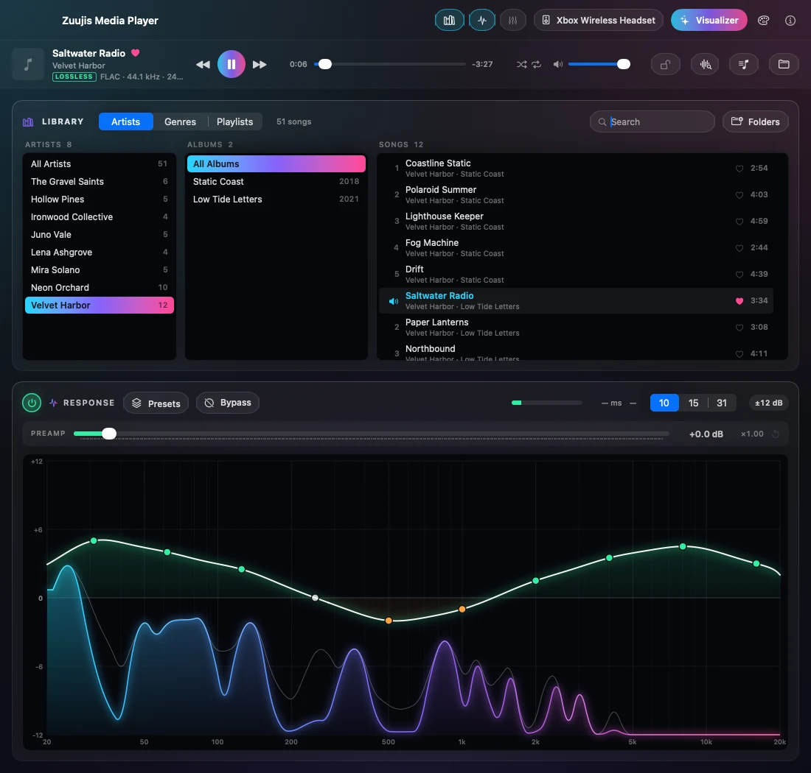

# AE2

A system-wide equalizer for macOS. It shapes and boosts whatever your Mac is
playing (music, videos, games, calls) on whichever output you are using, with
no virtual audio driver to install.



- **10, 15 or 31 band graphic EQ**, from 20 Hz to 20 kHz, ±24 dB per band.
- **Master gain up to +24 dB**, for quiet laptops, speakers and headphones.
- **17 built-in presets** (Bass Boost, Vocal, Podcast/Voice, Night Mode and
  more), plus your own. Presets can be saved, imported and exported as JSON.
- **A profile for each output device.** A curve set for your headphones comes
  back automatically when you switch back to them; your TV keeps its own.
- **A response graph** that draws the EQ's curve over the live spectrum. Drag
  across it to draw the curve you want; double-click a band to reset it.
- **Bypass** (⌘B) to compare the sound with and without the EQ.
- **A built-in file player** for lossless audio (FLAC, ALAC, WAV, AIFF) and
  MP3/AAC, with a playlist, gapless playback and Now Playing, played through
  the same EQ.
- **A visualizer window** with 50 audio-driven modes — fractals, a raymarched
  skyline, ridgelines, a retro sunset, particle swarms and more — a shuffle
  that moves between them on the beat, and import for MilkDrop `.milk`
  presets.

## How it works

AE2 uses the Core Audio *process tap* API added in macOS 26. When
you press Start, it:

1. Creates a **process tap** that captures everything the Mac is playing,
   except the app's own audio. While the tap is active, macOS mutes the
   original sound, so you hear only the equalized version.
2. Creates an **aggregate audio device** named "AE2 Output" that
   combines the tap with your real speakers or headphones.
3. Runs the captured audio through the EQ and plays the result on your output
   device, all in one clock-synced audio callback.

The tap and the aggregate device are both **private**: other apps, System
Settings and Audio MIDI Setup do not see them. Pressing Stop removes both and
your Mac's audio goes back to normal. If the app quits or crashes, macOS
removes them automatically.

### What it does not install

There is no kernel extension, no audio driver or plug-in, no login item and no
background service. The app only runs while you have it open.

### What it stores on your Mac

- **The app itself**, wherever you put it (usually `/Applications`).
- **Your presets, device profiles and imported MilkDrop presets** in
  `~/Library/Application Support/AudioEqualizer/`.
- **Your music library** (the folders you added and the tags read from them)
  in `library.json` in the same folder. Your music files stay where they are.
- **Its settings** (master gain, visualizer choices, whether device profiles
  are on) in its preferences file,
  `~/Library/Preferences/com.zuujis.AudioEqualizer.plist`.
- **The audio-capture permission** you grant it, which macOS keeps in its
  privacy settings under Privacy & Security → Screen & System Audio Recording.

## Getting started

### What you need

- A Mac with **Apple silicon** (M1 or later).
- **macOS 26 (Tahoe) or later.** The process-tap APIs it depends on are not
  available on older versions. Tested on macOS 26 and macOS 27.
- **Xcode 26 or later**, free from the Mac App Store.

### Build and install

```bash
git clone https://github.com/zuujiscom/AudioEqualizer.git
cd AudioEqualizer
xcodebuild -project AudioEqualizer.xcodeproj -scheme AudioEqualizer -configuration Release -derivedDataPath build
cp -R build/Build/Products/Release/AE2.app /Applications/
open /Applications/AE2.app
```

You can also open `AudioEqualizer.xcodeproj` in Xcode and press Run. The
project signs with Xcode's "Sign to Run Locally" setting, so no Apple
developer account is needed to build it for your own Mac.

### Use it

1. Press the **power button** in the header of the Response or Equalizer box, or choose
   **Engine → Start Engine**. The first time, macOS asks for permission to
   capture audio. Allow it, since the app cannot equalize audio it cannot hear.
2. Play something and move the sliders, or pick a preset with the **Presets** button in the same box header.
3. Choose 10, 15 or 31 bands to trade simplicity for precision. Presets adapt
   to whichever you pick.
4. Press the power button again to stop. Your Mac's audio returns to normal.

The EQ follows the Mac's current output. Switch outputs in System Settings →
Sound or the menu bar and it rebuilds the route for the new device, bringing
back that device's saved curve.

### Presets

- **File → Save Current as Preset…** saves your curve.
- **File → Import Preset…** and **Export Selected Preset…** share presets as
  JSON files.
- The **Presets** button (beside the power button and Bypass in the Response and
  Equalizer box headers) lists every preset and saves, imports,
  renames, duplicates, exports and deletes your own. **Reset EQ to Flat** (or
  the **Flat** button) clears the curve.
- Presets live in `~/Library/Application Support/AudioEqualizer/`. Use
  **File → Reveal Presets File in Finder** to get there.

### Player

The bar under the header plays audio files through the same EQ. It follows the
same controls as everything else: the faders, presets, master gain and Bypass
shape it, and the **power button switches the EQ on and off**, so with the
engine off the player plays flat. It uses its own audio path, separate from the
system route, so it never processes your other audio twice.

- **Player → Open Audio Files or Folder…** (⇧⌘O) replaces the playlist and
  plays; **Add to Playlist…** (⌥⌘O) appends. **Show Playlist** is ⇧⌘L.
- Keys: **Space** play/pause (main window), **⌘→ / ⌘←** next and previous,
  **⌥⌘→ / ⌥⌘←** forward and back 10 seconds, **⌘↑ / ⌘↓** player volume,
  **⌘.** stop.
- The keyboard's play, next and previous keys control the player while it is
  playing or paused, or while the app is in front. Claiming them directly needs
  **Accessibility** permission (System Settings → Privacy & Security); without
  it macOS decides who gets the keys.
- The output device follows each track's sample rate when the device supports
  it (the button beside the volume slider turns this off). It is skipped while
  the system EQ is running, and the previous rate is restored when playback
  stops.
- The lock button beside it turns on **exclusive output**: the player takes
  the output device for itself while it plays, so nothing mixes into the stream.
  Every other app is silent until playback stops, and it is off by default. It
  is released when the system EQ starts.

### Library

The **Library** card browses your music by artist, album and song. Add folders
with **Add Music Folder…** (or **Folders** in the card); folders on external
drives work too, and stay listed, marked offline, while the drive is unplugged.

- The first scan reads every file's tags (FLAC tags are read directly, since
  macOS ignores them). Later launches re-read only files that are new or have
  changed.
- Click an artist, then an album. Double-click a song to play it with the
  songs around it as the playlist. Right-click for **Play**, **Play Album**
  and **Add to Playlist**. The search box matches title, artist, album and
  genre.
- The buttons in the header show or hide the Library and choose the EQ view.
  The **Response graph** and the **Equalizer faders** are one or the other:
  clicking the one that is showing hides it, clicking the other switches. The
  graph has the preamp and the 10/15/31 band choice too, so it does everything
  the faders do. It also shows the player's spectrum while the EQ's power
  button is off (the faders and graph then show the curve you have set, but the
  player plays flat).

**Editing tags.** Right-click a song, album or artist and choose **Edit Info…**
to change title, artist, album, genre, year, track and disc. On an album or
artist the change applies to every song in it, and only the fields you edit
are touched. With **Write changes into the audio files** on (the default),
FLAC and MP3 files are updated, so other apps see the changes; the audio
itself is not touched. Other formats, and any file that cannot be written
(read-only or unplugged drive), keep the change in the library only, and an
alert says which. Turn the toggle off to keep every edit in the library only;
**Revert Library Edits** undoes those. The playlist shows a file's tags as
they were when it was loaded, so it may lag an edit until the song is reloaded.
Try it on a copy first if the files matter.

### Visualizer

Choose **Visualizer → Open Visualizer**, or pick a mode from the Visualizer
menu, or press the **Visualizer** button in the main window. **Shuffle** moves
through every visualization at random — the hand-tuned presets, freshly
remixed ones, and any MilkDrop presets you have imported — dissolving from one
to the next on a beat. Everything the visualizer draws is driven by the audio,
so it sits still in silence.

Move the pointer over the window for its controls, or use the keyboard:

| Key | Does |
| --- | --- |
| → or Space | Next visualization |
| ← | Previous |
| S | Shuffle on or off |
| L | Hold the current one |
| F | Full screen |

The timer button sets how long each visualization plays, from 10 seconds to
5 minutes.

**MilkDrop presets:** choose **File → Import MilkDrop Presets…** and select
`.milk` files or whole folders. Imported presets appear in the Visualizer menu.
They reproduce each preset's motion; MilkDrop's custom shapes, waves and shader
code are not supported. No presets are bundled with the app, because the
community packs have unclear licensing, so bring your own.

### Update

```bash
git pull
xcodebuild -project AudioEqualizer.xcodeproj -scheme AudioEqualizer -configuration Release -derivedDataPath build
```

Quit the app, copy the new `AE2.app` over the old one in
`/Applications`, and reopen it.

### Uninstall

1. Press Stop (or just quit the app), then delete it from `/Applications`.
2. To remove your presets, device profiles and settings too:

   ```bash
   rm -rf ~/Library/Application\ Support/AudioEqualizer
   defaults delete com.zuujis.AudioEqualizer
   ```

3. To remove its audio-capture permission, open System Settings → Privacy &
   Security → Screen & System Audio Recording, select AE2 and
   remove it with the minus button.

### Troubleshooting

- **No sound after pressing Start.** Check that AE2 is allowed
  under System Settings → Privacy & Security → Screen & System Audio Recording.
  Then stop and start the engine.
- **Sound is distorted.** Lower the master gain, or pull the boosted bands
  down. Stacking large boosts on top of master gain clips.
- **Audio stays silent after the app quits unexpectedly.** Reopen the app and
  press Start and then Stop, or switch the output device in System Settings →
  Sound and back.
- **Reporting a problem.** Choose **Engine → Copy Diagnostics** and paste the
  result into a [GitHub issue](https://github.com/zuujiscom/AudioEqualizer/issues).

## License

AE2 is free software, released under the
[GNU General Public License, version 3 or (at your option) any later version](LICENSE)
(GPL-3.0-or-later). You can use, study, change and share it. If you
distribute a modified version, you must release its source under the same
license.
